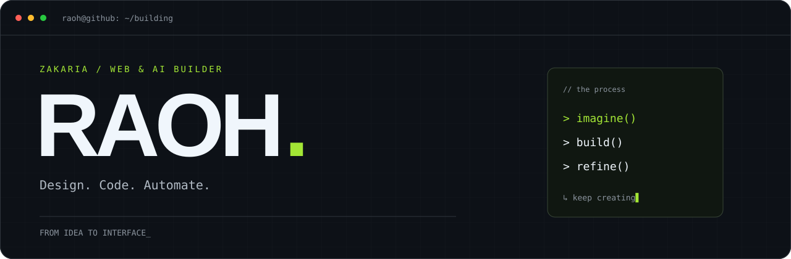

<p align="center">
  
</p>

<p align="center">
  <strong>Des idées au produit. Du design au dernier détail.</strong><br />
  Je construis des expériences web et j'explore l'IA pour mieux créer.
</p>

<p align="center">
  <a href="#ce-que-je-construis">Projets & exploration</a> ·
  <a href="#ma-boîte-à-outils">Stack</a> ·
  <a href="https://github.com/Raoh92-gif?tab=repositories">GitHub</a>
</p>

---

### `01 / about`

Salut, moi c'est **Zakaria**, alias **RAOH** 👋

J'aime partir d'une idée et lui donner une vraie forme : une interface qui attire l'œil, des interactions qui font sens et du code qui tient la route.

En ce moment, je travaille sur le **développement web**, le **design d'interfaces** et les **workflows avec des agents IA**. Mon terrain de jeu : relier créativité, technique et automatisation.

```text
design → build → test → refine
           ↑______________|
```

<h3 id="ce-que-je-construis">02 / Ce que je construis</h3>

### MABDA · Création web
Un projet d'agence web pour les indépendants, artisans et petites entreprises. Je travaille sur l'identité, l'expérience du site et le parcours qui permet de présenter son projet simplement.

**En développement** · Design d'interfaces · Développement web

### Glucy · Application du quotidien
Une application d'information nutritionnelle en développement, pensée pour rendre les informations alimentaires plus faciles à comprendre et à consulter.

**En développement** · Conception produit · Expérience utilisateur

> **Ma façon de construire :** je définis la direction, j'affine les parcours et je teste les résultats, avec l'IA comme partenaire de prototypage et de développement.

<sub>Ces présentations donnent un aperçu de mes projets ; le code et les détails de conception restent privés.</sub>

<h3 id="ma-boîte-à-outils">03 / Ma boîte à outils</h3>

<p>
  
  
  
  
  
  
</p>

**Et au milieu de tout ça :** agents IA, outils MCP, automatisation et beaucoup d'itérations.

---

<p align="center"><code>Curieux par défaut. Builder par envie.</code><br /><sub>RAOH / Toujours quelque chose en construction.</sub></p>
