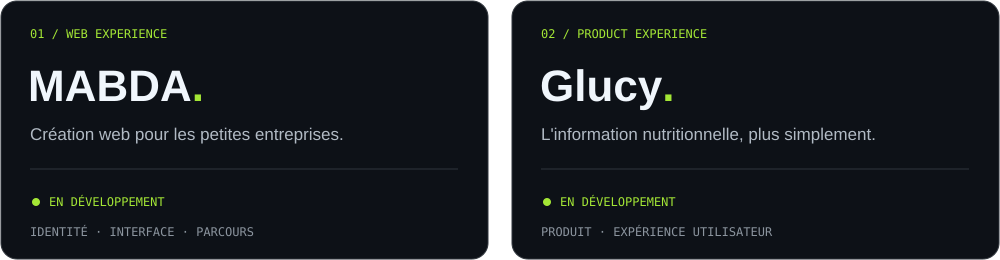

<p align="center">
  
</p>

<p align="center">
  <strong>Des idées au produit. Du design au dernier détail.</strong><br />
  Je construis des expériences web et j'explore l'IA pour mieux créer.
</p>

<p align="center">
  <a href="#02--projets-en-construction">Projets</a> ·
  <a href="#03--activité">Activité</a> ·
  <a href="#04--ma-boîte-à-outils">Stack</a> ·
  <a href="https://github.com/Raoh92-gif?tab=repositories">GitHub</a>
</p>

---

### `01 / about`

Salut, moi c'est **Zakaria**, alias **RAOH** 👋

J'aime partir d'une idée et lui donner une vraie forme : une interface qui attire l'œil, des interactions qui font sens et du code qui tient la route.

En ce moment, je travaille sur le **développement web**, le **design d'interfaces** et les **workflows avec des agents IA**. Mon terrain de jeu : relier créativité, technique et automatisation.

```text
design → build → test → refine
           ↑______________|
```

### 02 / Projets en construction

<p align="center">
  
</p>

<details>
<summary><strong>↳ Découvrir MABDA</strong> — création web</summary>

Un projet d'agence web pour les indépendants, artisans et petites entreprises. Je travaille sur l'identité, l'expérience du site et le parcours qui permet de présenter son projet simplement.

**En développement** · Design d'interfaces · Développement web

</details>

<details>
<summary><strong>↳ Découvrir Glucy</strong> — application du quotidien</summary>

Une application d'information nutritionnelle en développement, pensée pour rendre les informations alimentaires plus faciles à comprendre et à consulter.

**En développement** · Conception produit · Expérience utilisateur

</details>

<details>
<summary><strong>↳ Comment je construis avec l'IA</strong></summary>

Je définis la direction, j'affine les parcours et je teste les résultats, avec l'IA comme partenaire de prototypage et de développement.

Mon fil conducteur : une idée claire, une interface utile, des retours concrets et des améliorations successives.

</details>

<sub>Un aperçu de mes projets ; le code et les détails de conception restent privés.</sub>

### 03 / Activité

<p align="center">
  <a href="https://github.com/Raoh92-gif?tab=overview">
    
  </a>
</p>

<p align="center"><sub>Activité visible publiquement · Mes projets principaux sont dans des dépôts privés.<br />Carte fournie par <a href="https://github.com/DenverCoder1/github-readme-streak-stats">GitHub Readme Streak Stats</a>.</sub></p>

### 04 / Ma boîte à outils

<p>
  
  
  
  
  
  
</p>

**Et au milieu de tout ça :** agents IA, outils MCP, automatisation et beaucoup d'itérations.

---

<p align="center"><code>Curieux par défaut. Builder par envie.</code><br /><sub>RAOH / Toujours quelque chose en construction.</sub></p>
